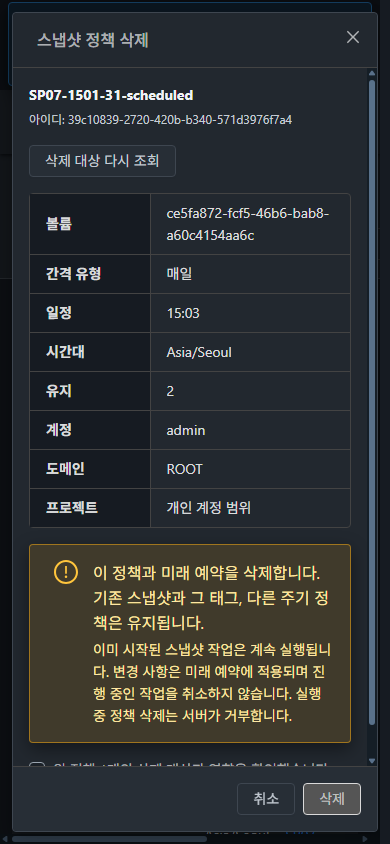
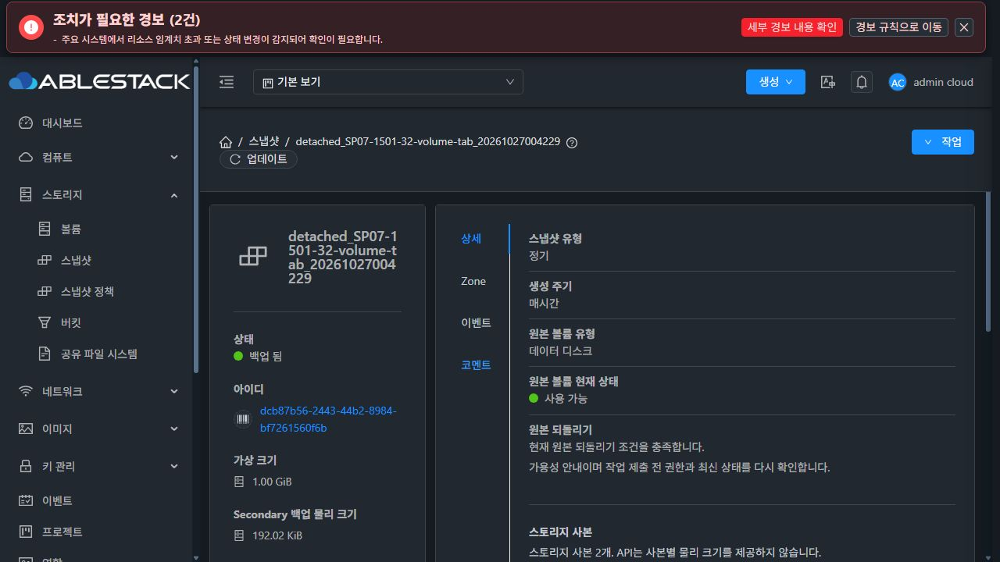

# SP-07 #1501 삭제 대상 확인 공통화와 안전한 결과 확인

**구현·양쪽 배포 완료 / 31번 자연 예약 검증 재개 대기 — 2026-10-27 KST. #1501은 OPEN이다.** 32번 API·실제 UI·자연 예약·보존·정리는 완료했다. 31번의 비어 있지 않은 스냅샷/태그 보존·실행 중 삭제 거부·완료 후 삭제와 최종 시험 자원 정리는 아직 완료로 판정하지 않는다. 보조 스토리지가 기존 90% 임계값을 초과했으며, 기존 운영 파일과 전역 설정을 유지한 상태에서 별도 선택을 기다리고 있다.

대상 [#1501](https://github.com/ablecloud-team/ablestack-cloud/issues/1501), 부모 [#1494](https://github.com/ablecloud-team/ablestack-cloud/issues/1494). 작업 브랜치 `dhslove/epic-1494-snapshot-policies`, 시작 기준 `35f3672cb67a9cbe5b728dc8e409c6af6736bbab`. [설계](../../design/snapshot-policy-1494/SP-07.ko.md).

## 설계와 구현

- 정책 메뉴의 행 우클릭과 볼륨 정기스냅샷 탭이 같은 삭제 확인창을 사용한다. 최신 볼륨 이름/UUID, 정책 UUID, 주기·일정·시간대·보관 수, 계정·도메인·프로젝트를 표시하고 삭제 영향과 확인 체크를 제공한다.
- 정책·미래 예약 삭제와 기존 스냅샷·그 태그·다른 주기의 보존을 구분한다. 시작된 작업은 계속 실행되며 실행 중 삭제는 서버가 거부한다.
- 선택 배열과 우클릭 행을 혼동하지 않는다. 제출 전 정책 fingerprint와 볼륨 소유 범위/이름을 재조회하며 변경·조회 실패 시 확인을 해제한다. 권한·프로젝트·경로·로그인·대상 변경과 늦은 응답은 폐기한다. 잘못된 레거시 일정도 읽기/삭제할 수 있다.
- `deleteSnapshotPolicies`의 `ids`에는 고정 UUID 한 개만 보낸다. 동기 API의 성공 응답과 동일 읽기 범위의 정책 부재를 모두 확인한 뒤 성공 처리한다. 네트워크/5xx/응답 불명확 시 재삭제를 막고 결과 조회만 허용한다. 목록 부재만으로 삭제와 표시·접근 범위 변화를 구분할 수 없으므로 성공 응답 없는 부재를 성공으로 오판하지 않는다. 실제 양쪽 배포 API는 이번 시험의 비표시 정책도 일반 소유자 목록에 포함했다. 숨겨졌다고 가정하지 않고 관찰 결과를 기록했다.
- 컴퓨트 > 가상머신의 공통 MoldDialog·테마 토큰·32px/14px/4px 버튼과 하단 취소→삭제 순서를 사용한다. 닫힘 애니메이션 후에만 부모가 창을 정리하며 사라진 행 대신 같은 화면 도구 모음에 초점을 돌린다.

## 검사·배포

집중 검사 **11 suites / 202 tests PASS**, lint·production build PASS. 전체 집중 검사는 `aa927421fb0`에서 수행했고, 테스트 스텁의 린트 호환 표현만 바꾼 최종 `5f58e1ea3743b4455a3b9b2ba523515ac8635358`에서는 삭제 집중 검사 **31 tests**를 다시 수행했다. 최종 lint와 생산 빌드는 이 최종 소스이다. [검사 결과](evidence/unit-result.json).

WSL ext4 `/home/ablecloud/work/dhslove/cloud-snapshot-policy-1494`에서 UI만 빌드했다. Maven·전체 Cloud 빌드·Actions dispatch·qemu/FTCTL 빌드는 수행하지 않았다. 집중 검사와 실환경 검증을 전체 Cloud CI로 확대하지 않는다.

최종 구현 소스의 등록 check-run·status·Actions run은 각각 0개다. 등록된 검사가 없다는 의미이며 전체 CI 통과로 해석하지 않는다. [GitHub 조회](evidence/github-source-checks.json).

동일한 정적 파일 **931개**, `app.95671954.js`를 양쪽 활성 `/usr/share/cloudstack-management/webapp`에 배포했다. archive SHA256은 `9058d7731f856e88d9f16746571d919fcb9b829d649306e92838730bd04b6d09`이다. WEB-INF/META-INF·원래 정적 파일·설정 7개·관리 JAR·PID·기존 FTCTL/SP-01/02/04/05/08 마커와 32번 운영 디스크를 보존했다. 서비스 재시작은 하지 않았다.

| 환경 | PID 유지 | 관리 JAR SHA256 유지 | 런타임 |
|---|---|---|---|
| 31 GFS2 | 3512207 | `62e3ece1b533f1a2474168b84fdb026a971aa5c55255341c3a9354324c419291` | mold active / client 200 / WEB-INF 존재 |
| 32 RBD | 3477070 | `916884ed998dfae21e3d725c2f06b2c75a2e2d2f4c214f16060ef697e3fd1419` | mold active / client 200 / WEB-INF 존재 |

[31 배포](evidence/31-ui-deploy.json) · [32 배포](evidence/32-ui-deploy.json) · [31 런타임](evidence/31-runtime-final.json) · [32 런타임](evidence/32-runtime-final.json). 최종 백업은 31 `/root/snapshot-policy-1501-20261027-ui-5f58e1ea374-backup`, 32 `/nfs/snapshot-policy-1501-20261027-ui-5f58e1ea374-backup`에 보존했다. 먼저 배포한 후보 `ddafa9bcee4`의 백업도 보존했다.

## 실환경 검증

31 GFS2·32 RBD에 분리된 DATADISK 4개, 정책 10개, 일반 계정/프로젝트 1개씩을 사용한다. 기존 시험 스냅샷 백업을 읽어 복제했으며 운영 VM에 연결하지 않는다. API 성공/오류, 실제 UI 요청, 독립 SQL의 정책·예약·태그·상세·스냅샷·사본, GFS2/RBD/보조 파일을 대조한다.

| 항목 | 31 GFS2 | 32 RBD | 근거/범위 |
|---|---|---|---|
| 메뉴·볼륨 탭 × 네 주기 확인·취소 | PASS 8건 | PASS 8건 | UUID/볼륨/주기/일정/TZ/보관 수/소유 정보, 확인 초기 해제·삭제 비활성 |
| 취소 후 데이터 보존 | PASS | PASS | 정책 10·예약 8개 및 태그/상세 무변경 독립 SQL |
| 메뉴 정상 단일 삭제 | PASS | PASS | 고정 UUID 한 개의 POST 200, API 성공 및 부재 재조회 |
| 볼륨 탭 정상 삭제·조회 복구 | PASS | PASS | POST 성공 뒤 검증 GET만 503, 읽기 재시도만으로 완료·추가 DELETE 없음 |
| 제출 전 조회 503 | PASS | PASS | 요약 유지·확인 해제, DELETE 없음, 명시 재조회 후 정상 삭제 |
| 확인 중 보관 수 2→3 변경 | PASS | PASS | DELETE 차단, 최신 값 3 재조회·재확인 후 삭제 |
| 다른 세션에서 대상 제거 | PASS | PASS | 삭제 요청 없음, 재조회 시 대상 요약 제거, 성공 오판 없음 |
| 서버 성공 응답 유실 | PASS | PASS | 서버에서는 삭제됐어도 UI는 503/미확인 유지, 재조회 시 부재만으로 성공하지 않음 |
| 소유자 개인·프로젝트 삭제 | PASS | PASS | 각각 실제 200, 프로젝트 요청에 올바른 projectid |
| 확인창을 연 뒤 역할 철회 | PASS 432 | PASS 432 | 정책/태그 유지·요약 보존·명시 재조회 필요 |
| 조회 전용 개인·프로젝트 | PASS | PASS | 최신 번들에서 작업 비노출 4개 화면, API 432 |
| 다른 계정 삭제 | PASS 531 | PASS 531 | 독립 API 및 정책/예약 무변경 |
| 비표시 정책의 불명확 결과 재조회 | PASS | PASS | DB에 남은 정책이 실제 목록에도 포함됨. 재삭제 없이 재조회·재확인 요구 |
| 실제 자연 예약 진행 중 삭제 431 | **대기** | PASS | 아래 동일 job/snapshot 연결 |
| 자연 예약 완료 후 정책 삭제·스냅샷/태그 보존 | **대기** | PASS | 비어 있지 않은 BackedUp 스냅샷/2개 태그/보조 파일 |
| 최종 전용 자원·스토리지 정리 | **대기** | PASS | 31 자원은 아래와 같이 예약을 중지해 보존 |

[최종 UI 확인 기록](evidence/ui-checks-final.json) · [31 네트워크](evidence/31-ui-network-final.json) · [32 네트워크](evidence/32-ui-network-final.json) · [최종 번들 식별](evidence/final-session.json) · [조회 전용 UI](evidence/acl-ui.json). 기록은 최종 배포 이후 시간으로 후보 기록과 분리했다. 초기 재로딩/장시간 대기 중 일부 네트워크 버퍼는 잘렸으므로 전체 네트워크 포착을 주장하지 않는다. 후속 개별 요청/응답과 독립 SQL을 함께 대조했고, 취소 16건은 별도의 무변경 SQL로 확인했다. 키보드 취소의 좁은 수집 구간에서도 삭제 요청이 없었다.

[31 취소 무변경](evidence/31-cancellation-preservation.json) · [32 취소 무변경](evidence/32-cancellation-preservation.json) · [31 역할 경합](evidence/31-role-race-preservation.json) · [32 역할 경합](evidence/32-role-race-preservation.json). 삭제별 `*-after-preservation.json`은 대상 정책/예약/정책 태그·상세의 제거와 나머지 정책·예약·스냅샷·사본·원래 스냅샷 태그 행 ID의 유지를 검사한다.

31번 첫 응답 대기 시험은 검증 도구의 버튼 문구 단정 오류를 확인하는 동안 30초 요청 제한에 도달했다. 제한 후 Escape로 시험 창을 닫았으며 성공으로 집계하지 않았다. SQL로 실제 서버 삭제와 다른 정책 보존을 확인하고, 별도 전용 월간 정책에서 시간 내 503 주입·미확인 유지·재조회·재삭제 0건을 다시 검증했다. 잘못된 데이터/상태를 SQL로 만들어 성공을 대신하지 않았다.

## 가상머신 UI 표준·키보드·반응형

실제 컴퓨트 > 가상머신 삭제창을 열어 라이트/다크 양쪽에서 취소했다. 가상머신 삭제 요청은 수행하지 않았다. [표준 측정](evidence/vm-standard.json).

양 클러스터 라이트/다크 × 390×844 / 768×900 / 1280×720, **12개 화면**에서 모달/하단 버튼이 화면 안에 있고 가로 넘침이 없음을 확인했다. 14px·32px·4px 버튼, 테마 색상과 고정 하단 취소→삭제를 대조했다. 모바일에서 Space 확인, Tab 취소→삭제, Escape 취소와 초점 복귀를 실제로 수행했다. 처리 중 버튼/체크/닫기가 잠기며 서버 응답 대기 중 Escape도 창을 닫지 않았다.

첫 후보의 볼륨 탭 취소가 BODY로 초점을 잃는 문제를 발견해 afterClose 뒤에 부모가 정리되도록 수정했다. 최종 양쪽 메뉴/탭의 취소와 성공/조회 복구 후 활성 버튼으로 돌아오는 것을 확인했다. [후보 문제](evidence/candidate-focus-failure.json) · [최종 초점](evidence/focus.json) · [12개 레이아웃](evidence/layouts.json) · [원본 이미지 포맷·해상도·SHA256](evidence/images.json). 원본 픽셀을 편집하지 않았고 JPEG는 .jpg로 보존했다.

## 32번 자연 예약·보존·정리 완료

예정 시각 `2026-10-27 00:41:00 UTC`의 실제 스케줄러가 `00:42:29 UTC`에 스냅샷 `dcb87b56-2443-44b2-8984-bf7261560f6b`와 job `6e180e95-cb3a-4e13-8c43-c175f1c4ac5b`를 생성했다. Allocated/job=0에서 실제 UI 삭제 431을 확인했다. 시험 행 잠금은 90초 watchdog 안에서 **21.841초** 후 명시 해제했다. job/snapshot/예정 시각을 유지했고 수동 생성이나 SQL 상태 변경으로 자연 실행을 대신하지 않았다.

job=1/BackedUp 완료 후 같은 창에서 재조회·재확인하여 정책을 삭제했다. 기존 스냅샷·두 태그 `sp07-keep=한글 보존`, `sp07-remove=삭제 대상`의 원래 행 ID·두 저장소 사본과 **196,624바이트 Ready 보조 파일**을 보존했다. 실제 스냅샷 목록과 상세의 태그/사본도 확인했다.

[자연 예약·보존 통합 증거](evidence/32-natural-proof.json) · [보조 파일](evidence/32-secondary-preserved.json)

정상 API로 남은 정책 2개, 볼륨 4개, 자연 스냅샷 1개, 프로젝트/계정 1개씩을 정리했다. 스냅샷의 태그는 #1506의 미해결 자동 정리와 구분해 명시적 deleteTags로 먼저 정리했다. 정책 삭제 후 스냅샷 태그 보존 검증을 끝낸 뒤의 시험 청소이며 제품 자동 정리 성공으로 집계하지 않는다.

활성 시험 볼륨·정책·예약·스냅샷·비종결 사본·태그·정책 상세·계정/프로젝트·자원 제한·대기 job **0**, 볼륨 이력 Expunged 4개, 스냅샷 Destroyed 1개, RBD 이미지/trash/보조 파일 잔여 0이다. 기존 Zone/스토리지/VM 51/볼륨 51/스냅샷 7/역할 10개와 핵심 속성을 보존했다. [독립 SQL](evidence/32-cleanup-check.json) · [RBD](evidence/32-primary-final.json) · [보조 파일](evidence/32-secondary-final.json) · [기존 자원](evidence/32-preservation-result.json).

## 31번 재개 조건과 남은 자원

현재 보조 스토리지 사용량이 `secondary.storage.capacity.threshold=0.90`을 초과한다. 마지막 기록은 **338,140,594,176 / 375,626,137,600바이트(약 90.02%)**이다. 정수 퍼센트 표시만 보지 않고 원래 바이트와 실제 임계값을 대조했다. 새 자연 예약의 백업을 정상 완료로 판정할 수 없어 해당 단계를 시작하지 않았다. [실제 API와 설정](evidence/31-storage-capacity.json).

사용자에게 **시험 동안만 0.901로 변경 후 원복** 또는 **전역 설정 유지·공간 확보 후 검증**을 선택하도록 질문했다. 이 설정은 다른 스냅샷 작업에도 영향을 주므로 선택 전에는 변경하지 않는다. 기존 운영 파일을 삭제하지 않았다.

전용 볼륨 4개와 시험 계정/프로젝트 각 1개는 재개를 위해 남아 있다. 남은 정책은 볼륨 탭의 HOURLY `100ab48c-73ce-474a-be98-c29553bbe13d`, WEEKLY `7c755cdb-30b4-44f8-b63f-cae37fbd7591` 두 개다. 모두 예약 중지했으며 **미래 예약 0·스냅샷 0·진행 작업 0**이다. [대기 상태](evidence/31-pending-natural-state.json) · [중지 결과](evidence/31-paused-owned.json). 이를 최종 정리 완료로 집계하지 않는다.

재개 후 HOURLY를 가까운 UTC 분으로 설정하고 실제 자연 예약의 진행 중 삭제 431→명시 해제→BackedUp/job 성공→정책 삭제 200→스냅샷/태그/다른 정책 보존을 확인한다. 이어 네 볼륨과 계정/프로젝트·정책/스냅샷/태그·GFS2/보조 파일 잔여를 정상 API와 독립 SQL로 정리한다. 임시 설정 변경을 선택했다면 원래 0.90으로 복원하고 확인한다.

Windows 기존 FT 작업 3개, WSL 기존 FT 작업 11개는 HEAD·브랜치·status·binary diff 해시가 모두 같다. [Windows](evidence/protected-windows-result.json) · [WSL](evidence/protected-wsl-result.json).

## 검증 경계와 후속

SP-11 선택 삭제는 이번 단일 삭제에 포함하지 않는다. 다중 Zone 실복사·DST·전체 역할/다중 노드 장애의 전체 회귀는 #1507 범위다. 기존 스냅샷 삭제 뒤 태그 자동 정리는 #1506이며 시험 정리의 명시적인 deleteTags를 제품 자동 정리로 집계하지 않는다.

31번의 남은 검증·정리와 완료 기준 확인을 끝내기 전에는 #1501을 닫지 않는다. Epic은 현재 **6/13 완료·OPEN**을 유지한다. #1501 완료 후 다음 권장 작업은 **#1497(SP-03)** 월 일자 숫자 검색 오류 수정이다. 이후 #1503 정렬/페이지, #1504 운영 정보·문구, #1505 선택 삭제·범위 필터, #1506 스냅샷 태그 수명주기를 완료한 뒤 #1507 통합 회귀를 진행한다.
