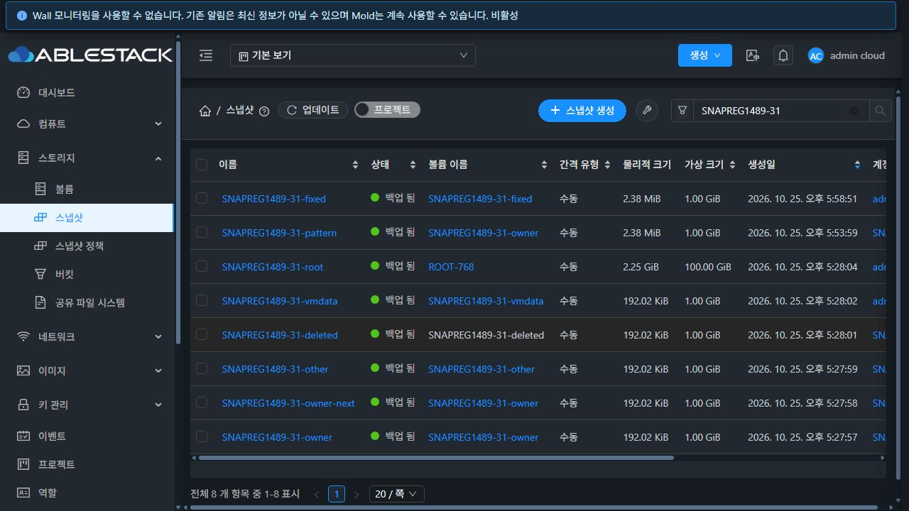

# #1489 스냅샷 통합 회귀 — 진행 보고

**최종 판정은 미완료다. #1489와 Epic #1473은 종료하지 않는다.**

31 GFS2와 32 RBD에서 새 전용 `SNAPREG1489-31/32` 자원으로 검증했다. 기존 하위 이슈의 완료를 통합 통과로 대체하지 않았다. 브랜치는 `dhslove/epic-1473-storage-snapshots`, 시작 기준은 `d7e0d6810849c0a389e66af7d899d6b79df842da`다.

## 발견 및 보완

1. **계정 삭제의 중복 사용량 기록.** 양쪽에서 개별 스냅샷 삭제 → 볼륨 삭제 → 계정 삭제 시 `SNAPSHOT.DELETE`가 2건이었다. 계정 정리는 개별 삭제의 잠금·실물 종료·사용량 처리 경로를 공유하고 자원 수량을 재계산한다. 의존 사본이나 미확인 정리가 남으면 디렉터리를 먼저 지우지 않는다. 다른 Zone의 사본 저장소도 포함한다. 재시험은 양쪽 모두 1건이다.
2. **31 절대 경로 삭제의 실물 잔여.** UI에서 만든 Running DATA 스냅샷은 DB `Destroyed`·job 성공인데 196,624바이트 NFS 파일이 남았다. KVM과 SSVM의 마운트 UUID 계산식이 달랐다. 저장소 URL에서 계산한 KVM UUID가 일치할 때만 SSVM export로 변환한다. 다른 export·경로 이탈·심볼릭 링크·공유 디렉터리는 거부한다. 새 Running 스냅샷은 양쪽에서 API·DB·NFS 삭제 결과가 일치했다.
3. **과거 종료 참조와 행 누락 재시도.** 관리자 강제 진단은 경로가 남은 과거 `Destroyed` 참조도 확인한다. 이미 같은 DB 값을 다시 쓰지 않아도 종료로 인정한다. NFS 과거 종료 사본은 상태 전이를 재생하지 않고 실물을 정리한다. 행까지 누락됐으면 감사 기록의 스냅샷·볼륨·저장소·경로를 확인해 NFS 정리를 재시도한다. 확인할 수 없는 주소는 실물 완료로 표시하지 않는다. 31 재시험은 `physicalcleanupcomplete=true`, `pendingcleanup=0`이다.
4. **32 Running 연결 실패의 원인 은폐.** 실제 Agent 원인은 `Gfs2VolumeAllocation` 누락이었다. 세 호스트에 필요한 기존 클래스와 의존 클래스를 반영했고 VM·FTCTL 보존을 확인했다. 서버는 응답 타입과 디스크 정보를 검사해 원래 Agent 원인을 전달한다. 같은 전용 볼륨의 재연결은 성공했다.
5. **보관 검증과 복사 경로 계약.** Agent는 검증한 파일의 export 상대 경로를 반환하고, 엔진은 정확한 백업 파일만 비교한다. 다른 사본 파일은 검증 근거로 인정하지 않는다. 누락 참조 상태의 한글·영문 표시도 추가했다.

## 확인한 범위

| 항목 | 31 | 32 | 증거 |
|---|---|---|---|
| 계정 정리의 삭제 이벤트 | 2 → 1 | 2 → 1 | `evidence/*-usage-*.json` |
| 새 Running DATA 일반 삭제 | API·DB·NFS 일치 | 동일 | `*-normal-absolute-after-oracle.json` |
| 행 누락 NFS 강제 복구 | 실물 완료·감사 0 | 추가 시험 남음 | `31-forced-recovery-after.json` |
| Running 볼륨 연결 | 최초 성공 | 반영 후 성공 | `32-hotattach-*.json` |
| 기본·동일 크기 명시·고정 오퍼링 복원 | 3개 일치 | 3개 일치 | `*-pattern-verify-restore-*.json` |
| 1GiB 스냅샷에 2GiB 복원 요청 | 명확히 거부 | 동일 | `*-restore-size-rejected.json` |
| QCOW2 ROOT 템플릿 VM | 게스트 OS·루트 FS 응답 | 동일 | `*-root-qcow2-boot.json` |
| QCOW2 DATA·ROOT 다운로드 | 형식·1/100GiB·200/206·원본 파일 해시 일치 | 동일 | `*-download-*.json` |
| 일반 사용자 API | 타인 범위/직접 작업 차단·자기 태그 성공 | 동일 | `*-acl-owner.json` |
| 읽기 전용 API/UI | 변경 차단·UI 작업/태그 추가 미노출 | 남음 | `31-read-only-*.json` |
| 새 UI 정적 배포 | 922개 해시·서버 파일 보존·200 | 동일 | `*-static-deploy.json` |

1GiB DATA 원본과 6개 복원의 처음/끝 패턴 및 전체 디코딩 디스크 SHA-256이 일치한다.
`7e95e6f5cd1446eb003c8d4c006f9d7fb286ec9550851dde1430a23f206e7f7f`.

ROOT 다운로드의 파일 해시와 새 VM의 게스트 응답을 확인했다. ROOT 템플릿의 전체 가상 디스크 비교나 RAW 조합까지 완료했다는 의미는 아니다.

## 빌드·배포·검사 구분

- WSL ext4에서 변경 Maven 모듈만 빌드·검사했다. KVM은 기존 누락 의존 클래스 검증을 위해 모듈 테스트를 실행했다.
- 앞선 서버 회귀 225개 통과 후, 마지막 복구 보완의 집중 서버 테스트 25개 통과. 최종 소스의 전체 서버 집중 회귀 재실행은 남아 있다.
- 엔진 57개, NFS 30개, KVM 48개 테스트가 통과했다. 스냅샷 UI 31개 스위트·469개 테스트와 UI production build도 통과했다.
- 저장소 경로의 `snapshots` 때문에 넓은 UI 검사도 실행됐다. 221개 스위트 중 7개·22개 테스트가 실패했다. 해당 실행 시 UI JS·테스트 소스는 시작 커밋과 같았다. VM NIC·AutoScale·게스트 IP·템플릿 ROOT·OAuth·Wall 알림 및 볼륨 공통 탭 테스트가 포함된다. 공통 탭의 fixture/timeout 기대값 불일치도 후속 대조가 필요하다. 전체 UI 검사 통과로 보고하지 않는다.
- 전체 Cloud GitHub Actions 빌드는 요청받지 않아 시작하지 않았다. 위 결과는 전체 Cloud CI 통과가 아니다.
- 관리 서버는 변경 클래스, SSVM은 삭제·경로·사본 조회 메서드를 선택 반영했다. 다른 메서드/JAR 항목 보존을 확인했다. 재시험 중 32 구버전 SSVM의 보조 메서드 차이도 보완했다. 배포 manifest는 `evidence`에 있다.

## 중단 및 남은 필수 항목

Windows Chrome의 실제 키보드·클립보드 연결 시 자동 승인 검토가 현재 브라우저 URL을 신뢰할 수준으로 확인하지 못해 이 턴의 Computer Use를 중단했다. 복사 알림만으로 실제 클립보드 바이트가 검증됐다고 처리하지 않는다.

- RAW ROOT/DATA 형식 조합, 원본 변경·되돌리기·삭제 후 복구, ROOT 전체 가상 데이터 비교.
- 양쪽 도메인 관리자·제한 권한·읽기 전용·프로젝트 전환의 API/UI 통합 권한 표.
- 다중 Zone·저장소의 실제 보관/복사·재시도·일부 실패·동시성·통신/지연 응답.
- 실제 정책 ID 8의 H/D/W/M 재시험, 증거 기반 이력 복구·멱등성, 스케줄러 실행·최대 보관 수.
- 목록·상세·탭·대화상자의 390/768/1280, 라이트/다크, 포커스·키보드와 최신 상태·중복 제출 통합 확인. StorPool 미노출 재확인.
- 정상 API 정리 후 API/DB/NFS/GFS2/RBD·trash·libvirt 활성 잔여 0과 이력 보존.

32의 `primary-only` 이름 fixture는 API 대조 결과 Primary·Secondary가 함께 존재했다. 일시적인 백업 설정 요청만으로 Primary-only가 성립했다고 간주하지 않았고 설정을 원래 값으로 복구했다. Secondary 손실 → 보관 재생성/강제 Primary 정리의 실물 시험은 아직 남아 있다.

## 보존 상태

전용 자원은 회귀 재개를 위해 보존했다. **정리 완료가 아니다.** 비종결 API 작업과 강제 정리 미확인 감사 항목은 양쪽 모두 0이다.

| 클러스터 | 활성 VM | 활성 볼륨 | 활성 스냅샷 | 활성 템플릿 |
|---|---:|---:|---:|---:|
| 31 | 2 | 10 | 9 | 2 |
| 32 | 2 | 10 | 10 | 2 |

도메인·계정·프로젝트·역할·오퍼링도 전용 접두어로 관리한다. 31 사용자 역할과 32 백업 설정은 원래 값으로 복구했다. 기존 운영 자원의 API 주요 속성 및 보호된 Windows/WSL FT 작업의 HEAD·status·diff 해시는 보존됐다.

API 원문·실행 원장·fixture registry·후속 스크립트는 비공개 WSL 경로 `/home/ablecloud/work/snapshot-regression-1489-20261025`에 있다. 공개 증거에서 다운로드 접근 URL과 인증 값은 제외했다. `manifest.json`은 증거 SHA-256 목록이다.
